# Results: DreaMS embeddings and molecular families

*Generated by `scripts/report.py` on 2026-11-09. Numbers only; the interpretation is in the notebook.*

## Datasets

|  | duncan_salinispora | crusemann_salstrep | crusemann_streptomyces | chevrette_insect | dorrestein_salbus | tahlan_streptomyces |
|---|---|---|---|---|---|---|
| dataset | Salinispora, Duncan et al. 2015 | Salinispora + Streptomyces, Crüsemann et al. 2017 | Streptomyces, Crüsemann et al. 2017 | Insect-associated actinobacteria, Chevrette et al. 2019 | Streptomyces albus J1074, Dorrestein lab | Clavulanic acid producing Streptomyces, Tahlan lab |
| MassIVE dataset (PoDP) | MSV000079284 | MSV000078836 | MSV000078839 | MSV000084723 | MSV000079519 | MSV000083835 |
| GNPS task | c22f44b14a3d450eb836d607cb9521bb | 9360fa514804487a9d39b7e7d7e6d514 | 840eadb054f74d74ae42152a08ed9628 | 927974dc1fe640d081b1467464815efa | 7e463ca89a7c41958a0d0b993ee52131 | b5eb34985777438aaf0f87e31889384c |
| GNPS workflow | METABOLOMICS-SNETS | METABOLOMICS-SNETS | METABOLOMICS-SNETS-V2 | METABOLOMICS-SNETS-V2 | METABOLOMICS-SNETS-V2 | METABOLOMICS-SNETS-V2 |
| fragment tolerance used by GNPS (Da) | 0.3 | 0.5 | 0.5 | 0.02 | 0.01 | 0.02 |
| min cosine for GNPS edges | 0.5 | 0.5 | 0.7 | 0.6 | 0.6 | 0.7 |
| spectra with peaks | 25935 | 6246 | 2834 | 1214 | 4707 | 12719 |
| spectra kept | 2903 | 3685 | 1973 | 825 | 2053 | 8903 |
| share kept | 11% | 59% | 70% | 68% | 44% | 70% |
| spectra kept that pass DreaMS's own check | 261 | 3443 | 0 | 761 | 2033 | 8894 |
| spectra in a GNPS family (size >= 2) | 139 | 2418 | 887 | 600 | 1398 | 5319 |
| GNPS families (size >= 2) | 20 | 299 | 148 | 100 | 193 | 1029 |
| GNPS edges between kept spectra | 289 | 4329 | 1695 | 1075 | 2670 | 8067 |
| library hits with a structure (SMILES) | 403 | 58 | 38 | 41 | 54 | 442 |

## Main numbers

Recovery@5 is the share of possible GNPS family partners among the 5 nearest neighbours (1.0 = all). Tanimoto compares the structures of library-annotated spectra. *Analog search* skips spectra of the same molecule.

|  | duncan_salinispora | crusemann_salstrep | crusemann_streptomyces | chevrette_insect | dorrestein_salbus | tahlan_streptomyces |
|---|---|---|---|---|---|---|
| A1 family recovery@5: DreaMS | 0.59 | 0.656 | 0.72 | 0.824 | 0.762 | 0.618 |
| A1 family recovery@5: binned cosine | 0.602 | 0.776 | 0.693 | 0.78 | 0.786 | 0.655 |
| A1 family recovery@5: precursor m/z | 0.121 | 0.343 | 0.232 | 0.21 | 0.148 | 0.04 |
| A1 family recovery@5: random | 0.007 | 0.017 | 0.01 | 0.036 | 0.016 | 0.002 |
| A2 median DreaMS sim., GNPS edges | 0.738 | 0.681 | 0.717 | 0.802 | 0.751 | 0.724 |
| A2 median DreaMS sim., random pairs | 0.426 | 0.206 | 0.193 | 0.197 | 0.174 | 0.149 |
| A3 largest DreaMS family (threshold 0.7) | 2,583 | 588 | 78 | 190 | 512 | 1,192 |
| A3 AMI, spectra in GNPS families (0.7) | 0.539 | 0.599 | 0.703 | 0.712 | 0.57 | 0.504 |
| B annotated spectra used | 388 | 21 | 23 | 29 | 32 | 420 |
| B unique structures | 173 | 16 | 18 | 23 | 27 | 324 |
| B1 Spearman with Tanimoto: DreaMS | 0.197 | 0.023 | 0.144 | 0.36 | 0.064 | 0.23 |
| B1 Spearman with Tanimoto: modified cosine | 0.255 | 0.097 | 0.121 | 0.378 | 0.234 | 0.259 |
| B1 Spearman with Tanimoto: binned cosine | 0.253 | 0.05 | 0.154 | 0.201 | 0.191 | 0.203 |
| B2 analog search top-1 Tanimoto: DreaMS | 0.2 | 0.265 | 0.313 | 0.484 | 0.268 | 0.4 |
| B2 analog search top-1 Tanimoto: modified cosine | 0.205 | 0.363 | 0.398 | 0.457 | 0.305 | 0.408 |
| B2 analog search top-1 Tanimoto: binned cosine | 0.197 | 0.144 | 0.315 | 0.476 | 0.29 | 0.375 |
| B2 analog search top-1 Tanimoto: random | 0.131 | 0.118 | 0.131 | 0.206 | 0.127 | 0.128 |

## Main numbers, only spectra that DreaMS's own rules accept

Our cleaning removes the peaks above the precursor before checking the DreaMS format A rules, so it keeps some spectra that DreaMS's own check (`DataFormatA().val_spec` on the spectrum as GNPS gives it) would reject. Here the experiments use only the spectra that pass DreaMS's own check (`--in-domain-only`). Empty: too few spectra left.

|  | duncan_salinispora | crusemann_salstrep | crusemann_streptomyces | chevrette_insect | dorrestein_salbus | tahlan_streptomyces |
|---|---|---|---|---|---|---|
| A1 family recovery@5: DreaMS | 0.713 | 0.654 |  | 0.817 | 0.762 | 0.618 |
| A1 family recovery@5: binned cosine | 0.862 | 0.775 |  | 0.767 | 0.784 | 0.654 |
| A1 family recovery@5: precursor m/z | 0.034 | 0.346 |  | 0.219 | 0.15 | 0.042 |
| A1 family recovery@5: random | 0.027 | 0.018 |  | 0.039 | 0.016 | 0.002 |
| A2 median DreaMS sim., GNPS edges | 0.701 | 0.68 |  | 0.802 | 0.75 | 0.724 |
| A2 median DreaMS sim., random pairs | 0.256 | 0.207 |  | 0.2 | 0.177 | 0.151 |
| A3 largest DreaMS family (threshold 0.7) | 20 | 580 |  | 188 | 500 | 1,192 |
| A3 AMI, spectra in GNPS families (0.7) | 0.733 | 0.593 |  | 0.7 | 0.568 | 0.503 |
| B annotated spectra used | 89 | 21 |  | 29 | 32 | 420 |
| B unique structures | 77 | 16 |  | 23 | 27 | 324 |
| B1 Spearman with Tanimoto: DreaMS | 0.051 | 0.023 |  | 0.36 | 0.064 | 0.23 |
| B1 Spearman with Tanimoto: modified cosine | 0.05 | 0.097 |  | 0.378 | 0.234 | 0.259 |
| B1 Spearman with Tanimoto: binned cosine | 0.057 | 0.05 |  | 0.201 | 0.191 | 0.203 |
| B2 analog search top-1 Tanimoto: DreaMS | 0.133 | 0.265 |  | 0.484 | 0.268 | 0.4 |
| B2 analog search top-1 Tanimoto: modified cosine | 0.135 | 0.363 |  | 0.457 | 0.305 | 0.408 |
| B2 analog search top-1 Tanimoto: binned cosine | 0.125 | 0.144 |  | 0.476 | 0.29 | 0.375 |
| B2 analog search top-1 Tanimoto: random | 0.117 | 0.118 |  | 0.206 | 0.127 | 0.128 |

## duncan_salinispora: Salinispora, Duncan et al. 2015

Embeddings: 2,903 spectra, DreaMS_embedding (pre-trained, no fine-tuning), CPU, 1171 s (2026-11-02).

**Cleaning (DreaMS format A)**

| step | spectra |
|---|---|
| read from GNPS | 25935 |
| removed: no peaks below the precursor m/z (looks like noise) | 9966 |
| removed: intensity range too small (max/min < 20) | 9477 |
| removed: fewer than 3 peaks above 10% intensity | 2404 |
| removed: charge is not +1 | 1074 |
| removed: precursor m/z above 1000 | 111 |
| kept for DreaMS | 2903 |

**Experiment A**

| metric | value | note |
|---|---|---|
| spectra used | 2,903 | after the DreaMS quality rules |
| spectra in GNPS families with >= 3 members | 125 | query spectra for A1 |
| A1 family recovery@5: DreaMS | 0.59 | 1.0 = all family partners in the top k |
| A1 family recovery@5: binned spectrum cosine | 0.602 | baseline, 1 Da bins |
| A1 family recovery@5: precursor m/z only | 0.121 | baseline |
| A1 family recovery@5: random | 0.007 | chance level |
| A2 median DreaMS similarity: GNPS edges | 0.738 | 289 edges |
| A2 median DreaMS similarity: random pairs | 0.426 | 4999 pairs |
| A2 Spearman (GNPS cosine vs DreaMS similarity) on GNPS edges | 0.263 |  |
| A3 DreaMS network settings | k=3, similarity >= 0.7 | as in the DreaMS networking tutorial |
| A3 DreaMS network edges | 6,399 |  |
| A3 DreaMS families (size >= 2) | 25 |  |
| A3 largest DreaMS family | 2,583 | spectra |
| A3 agreement with GNPS families (AMI) | -0.001 | 1 = identical, 0 = chance |
| A3 agreement with GNPS families (ARI) | -0 | 1 = identical, 0 = chance |
| A3 agreement (AMI), only spectra in GNPS families | 0.539 | 139 spectra |
| A3 DreaMS edges: same GNPS family | 123 | 1.9% |
| A3 DreaMS edges: different GNPS families | 7 | 0.1% |
| A3 DreaMS edges: involves a GNPS singleton | 6,269 | 98.0% |
| A3 GNPS edges also found by the DreaMS network | 34.9% | of 289 GNPS edges |

**Experiment A4: DreaMS network thresholds**

| threshold | edges | families (size >= 2) | spectra in families | largest family | AMI, all spectra | AMI, spectra in GNPS families | GNPS edges recovered (%) |
|---|---|---|---|---|---|---|---|
| 0.6 | 6760 | 14 | 2805 | 2763 | -0.0 | 0.266 | 41.9 |
| 0.7 | 6399 | 25 | 2681 | 2583 | -0.001 | 0.539 | 34.9 |
| 0.8 | 5329 | 28 | 2353 | 2272 | -0.01 | 0.362 | 23.2 |
| 0.85 | 3364 | 54 | 1761 | 1492 | -0.009 | 0.292 | 13.5 |
| 0.9 | 544 | 113 | 559 | 65 | 0.02 | 0.086 | 3.8 |
| 0.95 | 1 | 1 | 2 | 2 | -0.0 | -0.0 | 0.0 |

**Experiment B**

| metric | value | note |
|---|---|---|
| annotated spectra used | 388 | GNPS library hit with a valid structure |
| unique structures | 173 | first block of the InChIKey |
| fragment tolerance for modified cosine (Da) | 0.3 | taken from the GNPS job |
| B1 Spearman (Tanimoto vs DreaMS) | 0.197 | 75,078 pairs |
| B1 Spearman (Tanimoto vs modified cosine) | 0.255 | 75,078 pairs |
| B1 Spearman (Tanimoto vs binned spectrum cosine) | 0.253 | 75,078 pairs |
| B2 top-1 neighbour Tanimoto, any molecule: DreaMS | 0.451 | 388 query spectra |
| B2 top-1 neighbour Tanimoto, any molecule: modified cosine | 0.423 | 388 query spectra |
| B2 top-1 neighbour Tanimoto, any molecule: binned spectrum cosine | 0.394 | 388 query spectra |
| B2 top-1 neighbour Tanimoto, any molecule: random | 0.157 | chance level |
| B2 top-1 neighbour Tanimoto, any molecule: best possible | 0.801 | upper limit |
| B2 top-1 neighbour Tanimoto, other molecules only (analog search): DreaMS | 0.2 | 388 query spectra |
| B2 top-1 neighbour Tanimoto, other molecules only (analog search): modified cosine | 0.205 | 388 query spectra |
| B2 top-1 neighbour Tanimoto, other molecules only (analog search): binned spectrum cosine | 0.197 | 388 query spectra |
| B2 top-1 neighbour Tanimoto, other molecules only (analog search): random | 0.131 | chance level |
| B2 top-1 neighbour Tanimoto, other molecules only (analog search): best possible | 0.459 | upper limit |

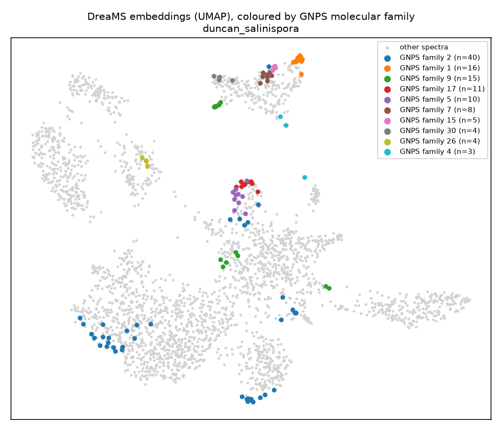

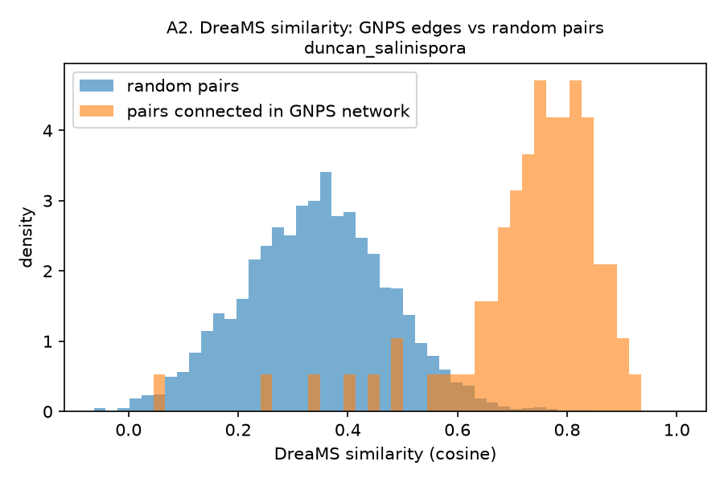

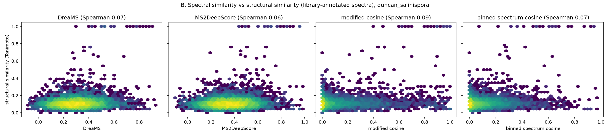

## crusemann_salstrep: Salinispora + Streptomyces, Crüsemann et al. 2017

Embeddings: 3,685 spectra, DreaMS_embedding (pre-trained, no fine-tuning), CPU, 1745 s (2026-11-02).

**Cleaning (DreaMS format A)**

| step | spectra |
|---|---|
| read from GNPS | 124950 |
| removed: empty spectrum (no peaks at all) | 118704 |
| removed: intensity range too small (max/min < 20) | 1542 |
| removed: charge is not +1 | 532 |
| removed: fewer than 3 peaks above 10% intensity | 395 |
| removed: precursor m/z above 1000 | 92 |
| kept for DreaMS | 3685 |

**Experiment A**

| metric | value | note |
|---|---|---|
| spectra used | 3,685 | after the DreaMS quality rules |
| spectra in GNPS families with >= 3 members | 2,138 | query spectra for A1 |
| A1 family recovery@5: DreaMS | 0.656 | 1.0 = all family partners in the top k |
| A1 family recovery@5: binned spectrum cosine | 0.776 | baseline, 1 Da bins |
| A1 family recovery@5: precursor m/z only | 0.343 | baseline |
| A1 family recovery@5: random | 0.017 | chance level |
| A2 median DreaMS similarity: GNPS edges | 0.681 | 4329 edges |
| A2 median DreaMS similarity: random pairs | 0.206 | 5000 pairs |
| A2 Spearman (GNPS cosine vs DreaMS similarity) on GNPS edges | 0.567 |  |
| A3 DreaMS network settings | k=3, similarity >= 0.7 | as in the DreaMS networking tutorial |
| A3 DreaMS network edges | 3,938 |  |
| A3 DreaMS families (size >= 2) | 205 |  |
| A3 largest DreaMS family | 588 | spectra |
| A3 agreement with GNPS families (AMI) | 0.486 | 1 = identical, 0 = chance |
| A3 agreement with GNPS families (ARI) | 0.245 | 1 = identical, 0 = chance |
| A3 agreement (AMI), only spectra in GNPS families | 0.599 | 2418 spectra |
| A3 DreaMS edges: same GNPS family | 2,273 | 57.7% |
| A3 DreaMS edges: different GNPS families | 286 | 7.3% |
| A3 DreaMS edges: involves a GNPS singleton | 1,379 | 35.0% |
| A3 GNPS edges also found by the DreaMS network | 22.6% | of 4329 GNPS edges |

**Experiment A4: DreaMS network thresholds**

| threshold | edges | families (size >= 2) | spectra in families | largest family | AMI, all spectra | AMI, spectra in GNPS families | GNPS edges recovered (%) |
|---|---|---|---|---|---|---|---|
| 0.6 | 6653 | 75 | 3235 | 2974 | 0.1 | 0.153 | 29.9 |
| 0.7 | 3938 | 205 | 2218 | 588 | 0.486 | 0.599 | 22.6 |
| 0.8 | 1924 | 112 | 1090 | 388 | 0.423 | 0.45 | 13.4 |
| 0.85 | 1090 | 80 | 672 | 228 | 0.338 | 0.342 | 7.7 |
| 0.9 | 294 | 48 | 251 | 75 | 0.117 | 0.114 | 2.3 |
| 0.95 | 4 | 4 | 8 | 2 | 0.001 | 0.001 | 0.1 |

**Experiment B**

| metric | value | note |
|---|---|---|
| annotated spectra used | 21 | GNPS library hit with a valid structure |
| unique structures | 16 | first block of the InChIKey |
| fragment tolerance for modified cosine (Da) | 0.5 | taken from the GNPS job |
| B1 Spearman (Tanimoto vs DreaMS) | 0.023 | 210 pairs |
| B1 Spearman (Tanimoto vs modified cosine) | 0.097 | 210 pairs |
| B1 Spearman (Tanimoto vs binned spectrum cosine) | 0.05 | 210 pairs |
| B2 top-1 neighbour Tanimoto, any molecule: DreaMS | 0.485 | 21 query spectra |
| B2 top-1 neighbour Tanimoto, any molecule: modified cosine | 0.503 | 21 query spectra |
| B2 top-1 neighbour Tanimoto, any molecule: binned spectrum cosine | 0.456 | 21 query spectra |
| B2 top-1 neighbour Tanimoto, any molecule: random | 0.151 | chance level |
| B2 top-1 neighbour Tanimoto, any molecule: best possible | 0.553 | upper limit |
| B2 top-1 neighbour Tanimoto, other molecules only (analog search): DreaMS | 0.265 | 21 query spectra |
| B2 top-1 neighbour Tanimoto, other molecules only (analog search): modified cosine | 0.363 | 21 query spectra |
| B2 top-1 neighbour Tanimoto, other molecules only (analog search): binned spectrum cosine | 0.144 | 21 query spectra |
| B2 top-1 neighbour Tanimoto, other molecules only (analog search): random | 0.118 | chance level |
| B2 top-1 neighbour Tanimoto, other molecules only (analog search): best possible | 0.418 | upper limit |

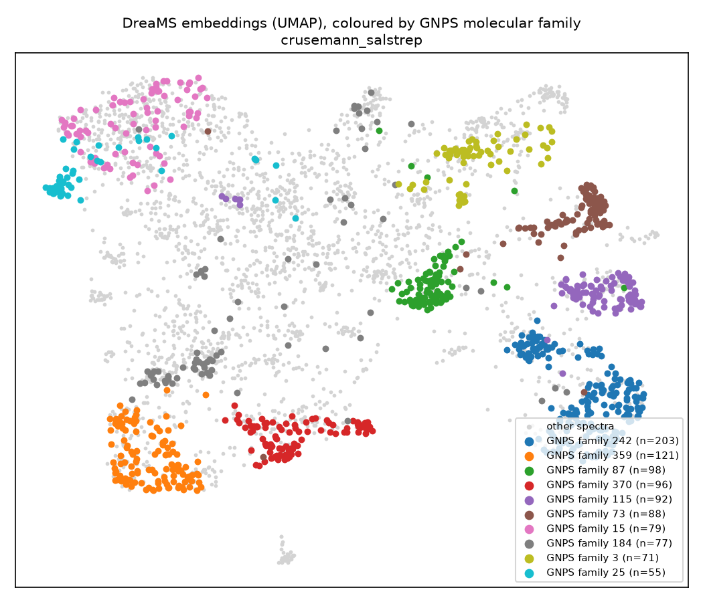

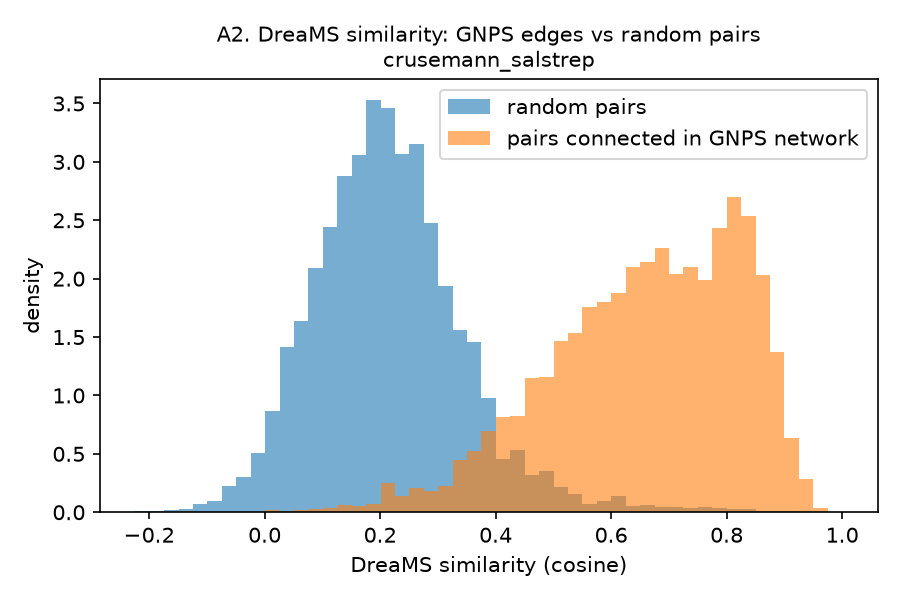

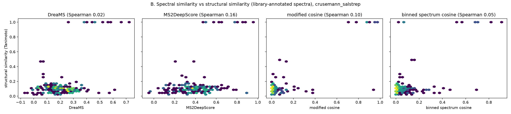

## crusemann_streptomyces: Streptomyces, Crüsemann et al. 2017

Embeddings: 1,973 spectra, DreaMS_embedding (pre-trained, no fine-tuning), CPU, 864 s (2026-11-02).

**Cleaning (DreaMS format A)**

| step | spectra |
|---|---|
| read from GNPS | 433081 |
| removed: empty spectrum (no peaks at all) | 430247 |
| removed: charge is not +1 | 416 |
| removed: fewer than 3 peaks above 10% intensity | 285 |
| removed: precursor m/z above 1000 | 108 |
| removed: intensity range too small (max/min < 20) | 52 |
| kept for DreaMS | 1973 |

**Experiment A**

| metric | value | note |
|---|---|---|
| spectra used | 1,973 | after the DreaMS quality rules |
| spectra in GNPS families with >= 3 members | 757 | query spectra for A1 |
| A1 family recovery@5: DreaMS | 0.72 | 1.0 = all family partners in the top k |
| A1 family recovery@5: binned spectrum cosine | 0.693 | baseline, 1 Da bins |
| A1 family recovery@5: precursor m/z only | 0.232 | baseline |
| A1 family recovery@5: random | 0.01 | chance level |
| A2 median DreaMS similarity: GNPS edges | 0.717 | 1695 edges |
| A2 median DreaMS similarity: random pairs | 0.193 | 5000 pairs |
| A2 Spearman (GNPS cosine vs DreaMS similarity) on GNPS edges | 0.452 |  |
| A3 DreaMS network settings | k=3, similarity >= 0.7 | as in the DreaMS networking tutorial |
| A3 DreaMS network edges | 1,362 |  |
| A3 DreaMS families (size >= 2) | 148 |  |
| A3 largest DreaMS family | 78 | spectra |
| A3 agreement with GNPS families (AMI) | 0.571 | 1 = identical, 0 = chance |
| A3 agreement with GNPS families (ARI) | 0.434 | 1 = identical, 0 = chance |
| A3 agreement (AMI), only spectra in GNPS families | 0.703 | 887 spectra |
| A3 DreaMS edges: same GNPS family | 798 | 58.6% |
| A3 DreaMS edges: different GNPS families | 72 | 5.3% |
| A3 DreaMS edges: involves a GNPS singleton | 492 | 36.1% |
| A3 GNPS edges also found by the DreaMS network | 34.5% | of 1695 GNPS edges |

**Experiment A4: DreaMS network thresholds**

| threshold | edges | families (size >= 2) | spectra in families | largest family | AMI, all spectra | AMI, spectra in GNPS families | GNPS edges recovered (%) |
|---|---|---|---|---|---|---|---|
| 0.6 | 2948 | 62 | 1629 | 1336 | 0.121 | 0.257 | 42.8 |
| 0.7 | 1362 | 148 | 949 | 78 | 0.571 | 0.703 | 34.5 |
| 0.8 | 536 | 87 | 427 | 40 | 0.432 | 0.445 | 19.2 |
| 0.85 | 237 | 56 | 216 | 34 | 0.258 | 0.255 | 10.3 |
| 0.9 | 98 | 31 | 99 | 22 | 0.122 | 0.117 | 4.8 |
| 0.95 | 14 | 8 | 20 | 3 | 0.018 | 0.018 | 0.8 |

**Experiment B**

| metric | value | note |
|---|---|---|
| annotated spectra used | 23 | GNPS library hit with a valid structure |
| unique structures | 18 | first block of the InChIKey |
| fragment tolerance for modified cosine (Da) | 0.5 | taken from the GNPS job |
| B1 Spearman (Tanimoto vs DreaMS) | 0.144 | 253 pairs |
| B1 Spearman (Tanimoto vs modified cosine) | 0.121 | 253 pairs |
| B1 Spearman (Tanimoto vs binned spectrum cosine) | 0.154 | 253 pairs |
| B2 top-1 neighbour Tanimoto, any molecule: DreaMS | 0.495 | 23 query spectra |
| B2 top-1 neighbour Tanimoto, any molecule: modified cosine | 0.487 | 23 query spectra |
| B2 top-1 neighbour Tanimoto, any molecule: binned spectrum cosine | 0.446 | 23 query spectra |
| B2 top-1 neighbour Tanimoto, any molecule: random | 0.151 | chance level |
| B2 top-1 neighbour Tanimoto, any molecule: best possible | 0.613 | upper limit |
| B2 top-1 neighbour Tanimoto, other molecules only (analog search): DreaMS | 0.313 | 23 query spectra |
| B2 top-1 neighbour Tanimoto, other molecules only (analog search): modified cosine | 0.398 | 23 query spectra |
| B2 top-1 neighbour Tanimoto, other molecules only (analog search): binned spectrum cosine | 0.315 | 23 query spectra |
| B2 top-1 neighbour Tanimoto, other molecules only (analog search): random | 0.131 | chance level |
| B2 top-1 neighbour Tanimoto, other molecules only (analog search): best possible | 0.527 | upper limit |

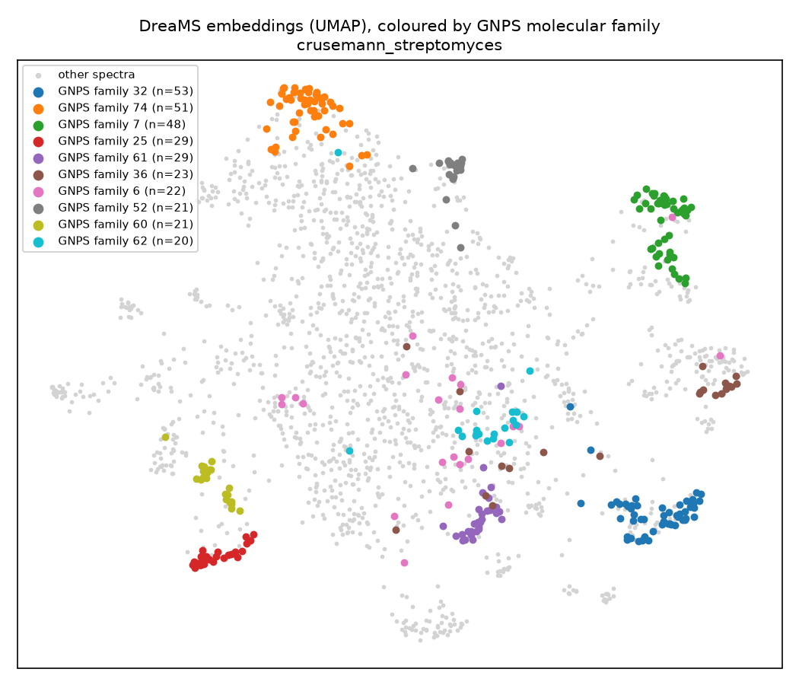

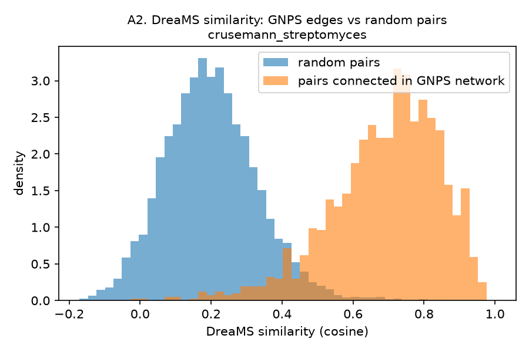

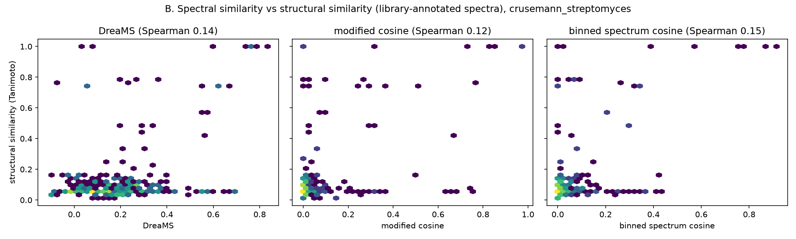

## chevrette_insect: Insect-associated actinobacteria, Chevrette et al. 2019

Embeddings: 825 spectra, DreaMS_embedding (pre-trained, no fine-tuning), CPU, 360 s (2026-11-09).

**Cleaning (DreaMS format A)**

| step | spectra |
|---|---|
| read from GNPS | 3117 |
| removed: empty spectrum (no peaks at all) | 1903 |
| removed: intensity range too small (max/min < 20) | 290 |
| removed: fewer than 3 peaks above 10% intensity | 55 |
| removed: precursor m/z above 1000 | 44 |
| kept for DreaMS | 825 |

**Experiment A**

| metric | value | note |
|---|---|---|
| spectra used | 825 | after the DreaMS quality rules |
| spectra in GNPS families with >= 3 members | 494 | query spectra for A1 |
| A1 family recovery@5: DreaMS | 0.824 | 1.0 = all family partners in the top k |
| A1 family recovery@5: binned spectrum cosine | 0.78 | baseline, 1 Da bins |
| A1 family recovery@5: precursor m/z only | 0.21 | baseline |
| A1 family recovery@5: random | 0.036 | chance level |
| A2 median DreaMS similarity: GNPS edges | 0.802 | 1075 edges |
| A2 median DreaMS similarity: random pairs | 0.197 | 4996 pairs |
| A2 Spearman (GNPS cosine vs DreaMS similarity) on GNPS edges | 0.577 |  |
| A3 DreaMS network settings | k=3, similarity >= 0.7 | as in the DreaMS networking tutorial |
| A3 DreaMS network edges | 997 |  |
| A3 DreaMS families (size >= 2) | 71 |  |
| A3 largest DreaMS family | 190 | spectra |
| A3 agreement with GNPS families (AMI) | 0.657 | 1 = identical, 0 = chance |
| A3 agreement with GNPS families (ARI) | 0.42 | 1 = identical, 0 = chance |
| A3 agreement (AMI), only spectra in GNPS families | 0.712 | 600 spectra |
| A3 DreaMS edges: same GNPS family | 747 | 74.9% |
| A3 DreaMS edges: different GNPS families | 71 | 7.1% |
| A3 DreaMS edges: involves a GNPS singleton | 179 | 18.0% |
| A3 GNPS edges also found by the DreaMS network | 42.7% | of 1075 GNPS edges |

**Experiment A4: DreaMS network thresholds**

| threshold | edges | families (size >= 2) | spectra in families | largest family | AMI, all spectra | AMI, spectra in GNPS families | GNPS edges recovered (%) |
|---|---|---|---|---|---|---|---|
| 0.6 | 1456 | 21 | 754 | 666 | 0.174 | 0.186 | 48.2 |
| 0.7 | 997 | 71 | 593 | 190 | 0.657 | 0.712 | 42.7 |
| 0.8 | 644 | 75 | 423 | 68 | 0.677 | 0.692 | 32.7 |
| 0.85 | 446 | 58 | 309 | 66 | 0.582 | 0.58 | 22.9 |
| 0.9 | 215 | 39 | 176 | 44 | 0.381 | 0.368 | 11.9 |
| 0.95 | 48 | 11 | 43 | 16 | 0.09 | 0.086 | 3.3 |

**Experiment B**

| metric | value | note |
|---|---|---|
| annotated spectra used | 29 | GNPS library hit with a valid structure |
| unique structures | 23 | first block of the InChIKey |
| fragment tolerance for modified cosine (Da) | 0.02 | taken from the GNPS job |
| B1 Spearman (Tanimoto vs DreaMS) | 0.36 | 406 pairs |
| B1 Spearman (Tanimoto vs modified cosine) | 0.378 | 406 pairs |
| B1 Spearman (Tanimoto vs binned spectrum cosine) | 0.201 | 406 pairs |
| B2 top-1 neighbour Tanimoto, any molecule: DreaMS | 0.583 | 29 query spectra |
| B2 top-1 neighbour Tanimoto, any molecule: modified cosine | 0.536 | 29 query spectra |
| B2 top-1 neighbour Tanimoto, any molecule: binned spectrum cosine | 0.584 | 29 query spectra |
| B2 top-1 neighbour Tanimoto, any molecule: random | 0.219 | chance level |
| B2 top-1 neighbour Tanimoto, any molecule: best possible | 0.648 | upper limit |
| B2 top-1 neighbour Tanimoto, other molecules only (analog search): DreaMS | 0.484 | 29 query spectra |
| B2 top-1 neighbour Tanimoto, other molecules only (analog search): modified cosine | 0.457 | 29 query spectra |
| B2 top-1 neighbour Tanimoto, other molecules only (analog search): binned spectrum cosine | 0.476 | 29 query spectra |
| B2 top-1 neighbour Tanimoto, other molecules only (analog search): random | 0.206 | chance level |
| B2 top-1 neighbour Tanimoto, other molecules only (analog search): best possible | 0.526 | upper limit |

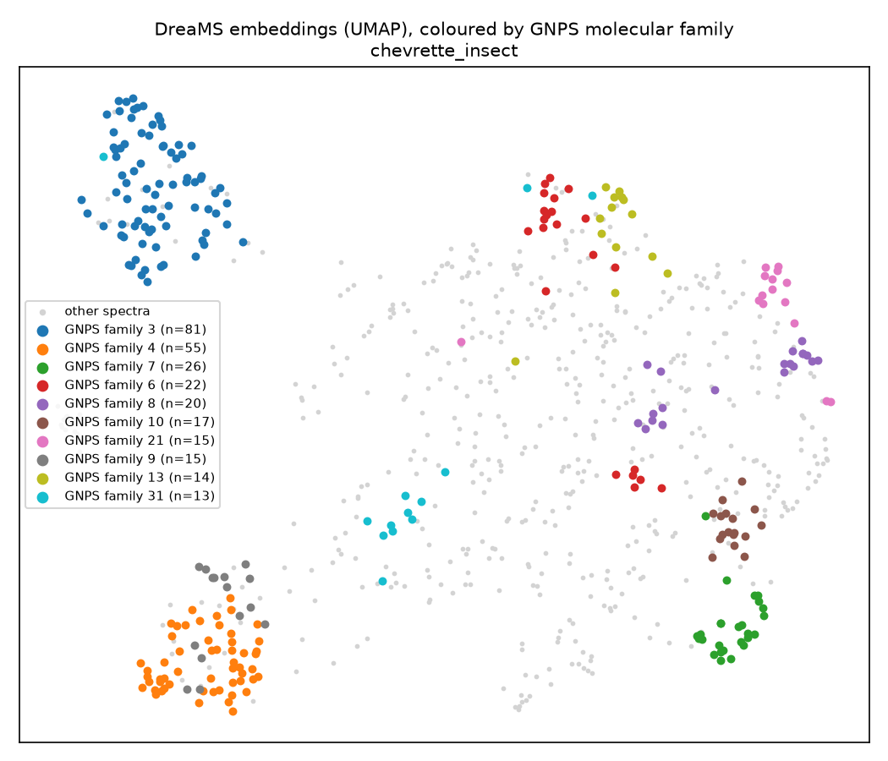

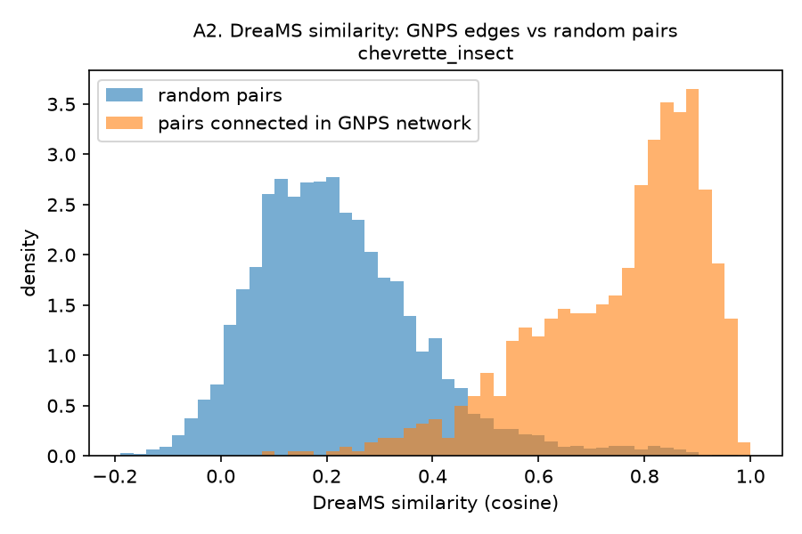

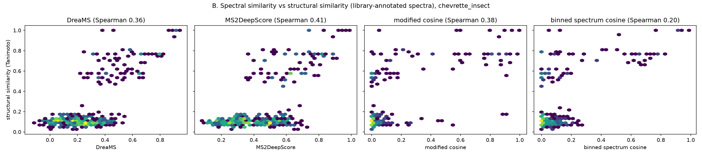

## dorrestein_salbus: Streptomyces albus J1074, Dorrestein lab

Embeddings: 2,053 spectra, DreaMS_embedding (pre-trained, no fine-tuning), CPU, 1556 s (2026-11-09).

**Cleaning (DreaMS format A)**

| step | spectra |
|---|---|
| read from GNPS | 4707 |
| removed: intensity range too small (max/min < 20) | 1396 |
| removed: charge is not +1 | 657 |
| removed: fewer than 3 peaks above 10% intensity | 533 |
| removed: precursor m/z above 1000 | 68 |
| kept for DreaMS | 2053 |

**Experiment A**

| metric | value | note |
|---|---|---|
| spectra used | 2,053 | after the DreaMS quality rules |
| spectra in GNPS families with >= 3 members | 1,214 | query spectra for A1 |
| A1 family recovery@5: DreaMS | 0.762 | 1.0 = all family partners in the top k |
| A1 family recovery@5: binned spectrum cosine | 0.786 | baseline, 1 Da bins |
| A1 family recovery@5: precursor m/z only | 0.148 | baseline |
| A1 family recovery@5: random | 0.016 | chance level |
| A2 median DreaMS similarity: GNPS edges | 0.751 | 2670 edges |
| A2 median DreaMS similarity: random pairs | 0.174 | 5000 pairs |
| A2 Spearman (GNPS cosine vs DreaMS similarity) on GNPS edges | 0.515 |  |
| A3 DreaMS network settings | k=3, similarity >= 0.7 | as in the DreaMS networking tutorial |
| A3 DreaMS network edges | 2,159 |  |
| A3 DreaMS families (size >= 2) | 149 |  |
| A3 largest DreaMS family | 512 | spectra |
| A3 agreement with GNPS families (AMI) | 0.535 | 1 = identical, 0 = chance |
| A3 agreement with GNPS families (ARI) | 0.138 | 1 = identical, 0 = chance |
| A3 agreement (AMI), only spectra in GNPS families | 0.57 | 1398 spectra |
| A3 DreaMS edges: same GNPS family | 1,505 | 69.7% |
| A3 DreaMS edges: different GNPS families | 275 | 12.7% |
| A3 DreaMS edges: involves a GNPS singleton | 379 | 17.6% |
| A3 GNPS edges also found by the DreaMS network | 39.9% | of 2670 GNPS edges |

**Experiment A4: DreaMS network thresholds**

| threshold | edges | families (size >= 2) | spectra in families | largest family | AMI, all spectra | AMI, spectra in GNPS families | GNPS edges recovered (%) |
|---|---|---|---|---|---|---|---|
| 0.6 | 3163 | 106 | 1702 | 1237 | 0.309 | 0.319 | 47.1 |
| 0.7 | 2159 | 149 | 1339 | 512 | 0.535 | 0.57 | 39.9 |
| 0.8 | 1165 | 162 | 840 | 79 | 0.5 | 0.505 | 27.2 |
| 0.85 | 697 | 130 | 561 | 57 | 0.368 | 0.366 | 18.3 |
| 0.9 | 333 | 95 | 328 | 42 | 0.22 | 0.214 | 9.8 |
| 0.95 | 81 | 38 | 103 | 20 | 0.06 | 0.059 | 2.6 |

**Experiment B**

| metric | value | note |
|---|---|---|
| annotated spectra used | 32 | GNPS library hit with a valid structure |
| unique structures | 27 | first block of the InChIKey |
| fragment tolerance for modified cosine (Da) | 0.01 | taken from the GNPS job |
| B1 Spearman (Tanimoto vs DreaMS) | 0.064 | 496 pairs |
| B1 Spearman (Tanimoto vs modified cosine) | 0.234 | 496 pairs |
| B1 Spearman (Tanimoto vs binned spectrum cosine) | 0.191 | 496 pairs |
| B2 top-1 neighbour Tanimoto, any molecule: DreaMS | 0.443 | 32 query spectra |
| B2 top-1 neighbour Tanimoto, any molecule: modified cosine | 0.444 | 32 query spectra |
| B2 top-1 neighbour Tanimoto, any molecule: binned spectrum cosine | 0.463 | 32 query spectra |
| B2 top-1 neighbour Tanimoto, any molecule: random | 0.138 | chance level |
| B2 top-1 neighbour Tanimoto, any molecule: best possible | 0.657 | upper limit |
| B2 top-1 neighbour Tanimoto, other molecules only (analog search): DreaMS | 0.268 | 32 query spectra |
| B2 top-1 neighbour Tanimoto, other molecules only (analog search): modified cosine | 0.305 | 32 query spectra |
| B2 top-1 neighbour Tanimoto, other molecules only (analog search): binned spectrum cosine | 0.29 | 32 query spectra |
| B2 top-1 neighbour Tanimoto, other molecules only (analog search): random | 0.127 | chance level |
| B2 top-1 neighbour Tanimoto, other molecules only (analog search): best possible | 0.522 | upper limit |

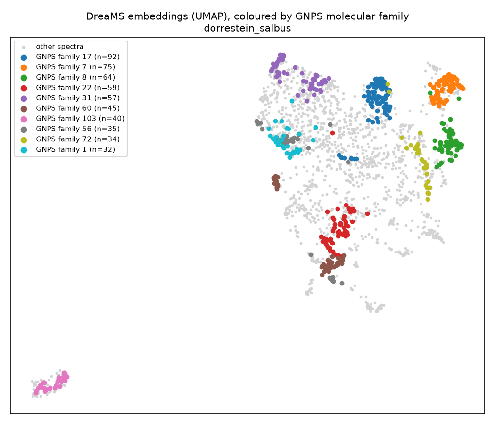

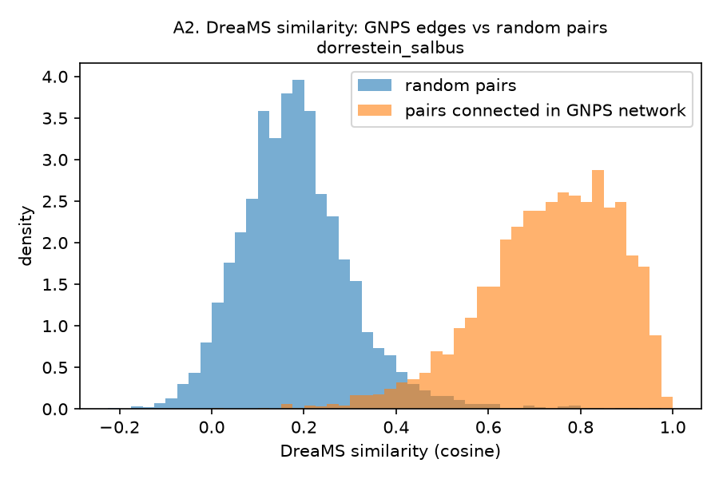

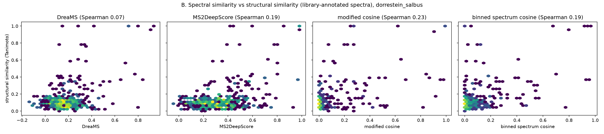

## tahlan_streptomyces: Clavulanic acid producing Streptomyces, Tahlan lab

Embeddings: 8,903 spectra, DreaMS_embedding (pre-trained, no fine-tuning), CPU, 4432 s (2026-11-09).

**Cleaning (DreaMS format A)**

| step | spectra |
|---|---|
| read from GNPS | 26065 |
| removed: empty spectrum (no peaks at all) | 13346 |
| removed: intensity range too small (max/min < 20) | 1519 |
| removed: fewer than 3 peaks above 10% intensity | 1392 |
| removed: charge is not +1 | 776 |
| removed: precursor m/z above 1000 | 129 |
| kept for DreaMS | 8903 |

**Experiment A**

| metric | value | note |
|---|---|---|
| spectra used | 8,903 | after the DreaMS quality rules |
| spectra in GNPS families with >= 3 members | 4,347 | query spectra for A1 |
| A1 family recovery@5: DreaMS | 0.618 | 1.0 = all family partners in the top k |
| A1 family recovery@5: binned spectrum cosine | 0.655 | baseline, 1 Da bins |
| A1 family recovery@5: precursor m/z only | 0.04 | baseline |
| A1 family recovery@5: random | 0.002 | chance level |
| A2 median DreaMS similarity: GNPS edges | 0.724 | 8067 edges |
| A2 median DreaMS similarity: random pairs | 0.149 | 8066 pairs |
| A2 Spearman (GNPS cosine vs DreaMS similarity) on GNPS edges | 0.485 |  |
| A3 DreaMS network settings | k=3, similarity >= 0.7 | as in the DreaMS networking tutorial |
| A3 DreaMS network edges | 7,784 |  |
| A3 DreaMS families (size >= 2) | 574 |  |
| A3 largest DreaMS family | 1,192 | spectra |
| A3 agreement with GNPS families (AMI) | 0.409 | 1 = identical, 0 = chance |
| A3 agreement with GNPS families (ARI) | 0.044 | 1 = identical, 0 = chance |
| A3 agreement (AMI), only spectra in GNPS families | 0.504 | 5319 spectra |
| A3 DreaMS edges: same GNPS family | 4,169 | 53.6% |
| A3 DreaMS edges: different GNPS families | 1,114 | 14.3% |
| A3 DreaMS edges: involves a GNPS singleton | 2,501 | 32.1% |
| A3 GNPS edges also found by the DreaMS network | 37.6% | of 8067 GNPS edges |

**Experiment A4: DreaMS network thresholds**

| threshold | edges | families (size >= 2) | spectra in families | largest family | AMI, all spectra | AMI, spectra in GNPS families | GNPS edges recovered (%) |
|---|---|---|---|---|---|---|---|
| 0.6 | 13505 | 302 | 7295 | 6080 | 0.12 | 0.161 | 46.0 |
| 0.7 | 7784 | 574 | 4884 | 1192 | 0.409 | 0.504 | 37.6 |
| 0.8 | 3536 | 492 | 2606 | 293 | 0.446 | 0.474 | 24.2 |
| 0.85 | 1892 | 344 | 1547 | 114 | 0.332 | 0.339 | 15.2 |
| 0.9 | 761 | 188 | 712 | 44 | 0.165 | 0.165 | 7.3 |
| 0.95 | 103 | 57 | 144 | 19 | 0.027 | 0.026 | 1.2 |

**Experiment B**

| metric | value | note |
|---|---|---|
| annotated spectra used | 420 | GNPS library hit with a valid structure |
| unique structures | 324 | first block of the InChIKey |
| fragment tolerance for modified cosine (Da) | 0.02 | taken from the GNPS job |
| B1 Spearman (Tanimoto vs DreaMS) | 0.23 | 87,990 pairs |
| B1 Spearman (Tanimoto vs modified cosine) | 0.259 | 87,990 pairs |
| B1 Spearman (Tanimoto vs binned spectrum cosine) | 0.203 | 87,990 pairs |
| B2 top-1 neighbour Tanimoto, any molecule: DreaMS | 0.543 | 420 query spectra |
| B2 top-1 neighbour Tanimoto, any molecule: modified cosine | 0.517 | 420 query spectra |
| B2 top-1 neighbour Tanimoto, any molecule: binned spectrum cosine | 0.506 | 420 query spectra |
| B2 top-1 neighbour Tanimoto, any molecule: random | 0.132 | chance level |
| B2 top-1 neighbour Tanimoto, any molecule: best possible | 0.775 | upper limit |
| B2 top-1 neighbour Tanimoto, other molecules only (analog search): DreaMS | 0.4 | 420 query spectra |
| B2 top-1 neighbour Tanimoto, other molecules only (analog search): modified cosine | 0.408 | 420 query spectra |
| B2 top-1 neighbour Tanimoto, other molecules only (analog search): binned spectrum cosine | 0.375 | 420 query spectra |
| B2 top-1 neighbour Tanimoto, other molecules only (analog search): random | 0.128 | chance level |
| B2 top-1 neighbour Tanimoto, other molecules only (analog search): best possible | 0.666 | upper limit |

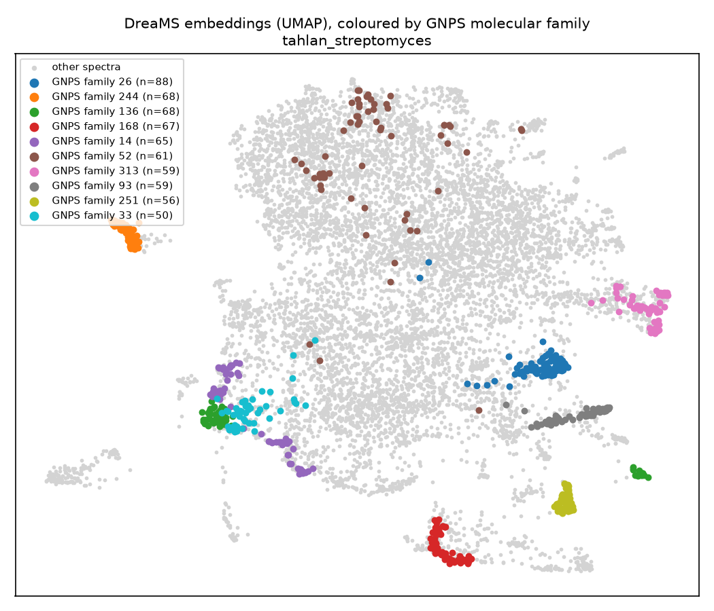

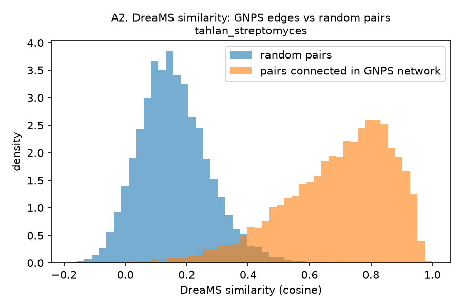

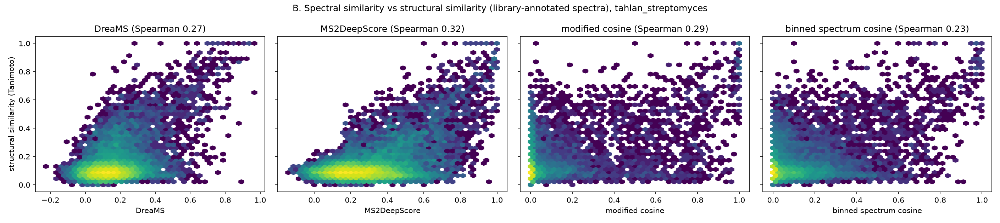
